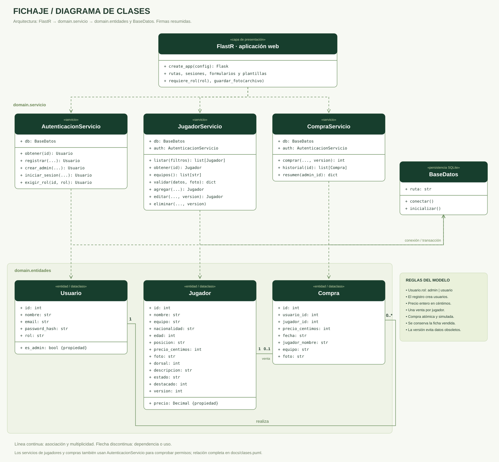
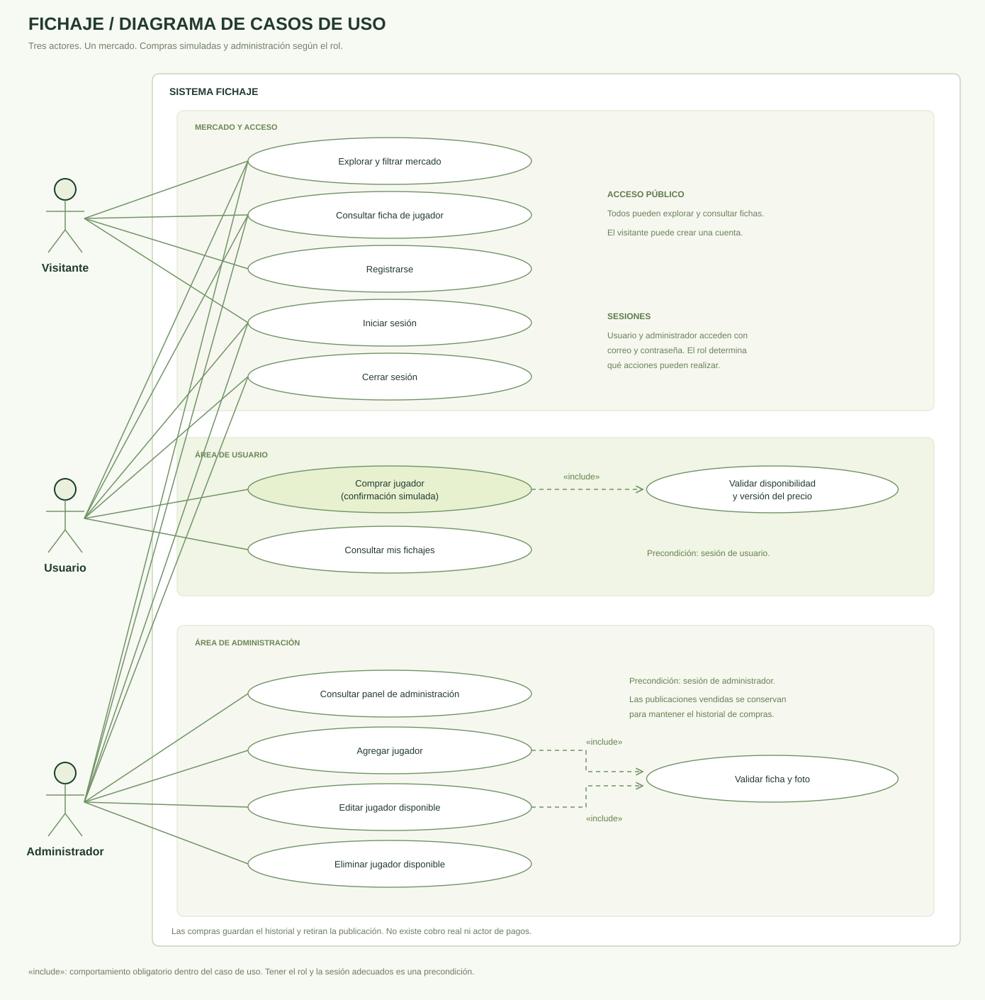

# Diagramas de Fichaje

Los diagramas también están disponibles en la página **/diagramas** de la aplicación.

## Diagrama de clases



[Fuente editable PlantUML](clases.puml).

- **Usuario** guarda la identidad, el hash de contraseña y el rol. Administrador y usuario son valores de `rol`; no se inventan subclases que no existen en el código.
- **Jugador** representa una publicación, con foto, equipo, posición y precio en céntimos. `version` detecta fichas que cambiaron mientras alguien las consultaba.
- **Compra** registra comprador, jugador, fecha y una copia de la ficha y el precio pactado.
- **AutenticacionServicio** registra, autentica y valida permisos.
- **JugadorServicio** consulta, valida, agrega, edita y elimina jugadores disponibles.
- **CompraServicio** realiza la compra dentro de una transacción y consulta el historial.
- **BaseDatos** abre conexiones SQLite, confirma o revierte transacciones y crea el esquema.
- **FlastR** es la capa web: fábrica de aplicación, rutas, formularios, sesiones, plantillas y archivos estáticos.

Un usuario tiene **0..*** compras y cada compra tiene **1** usuario. Un jugador tiene **0..1** compra y cada compra corresponde a **1** jugador.

El SVG simplifica las firmas para facilitar su lectura. La fuente PlantUML contiene las relaciones adicionales entre los servicios y la autenticación.

## Diagrama de casos de uso



[Fuente editable PlantUML](casos-de-uso.puml).

| Actor | Acciones |
| --- | --- |
| Visitante | Explorar y filtrar el mercado, ver fichas, registrarse, iniciar sesión. |
| Usuario | Iniciar y cerrar sesión, explorar el catálogo, ver fichas, confirmar compras simuladas y consultar sus fichajes. |
| Administrador | Iniciar y cerrar sesión, explorar el catálogo, consultar el panel, agregar, editar y eliminar publicaciones disponibles. |

`include` señala una acción que siempre se ejecuta dentro del caso de uso: comprar incluye validar disponibilidad y versión; agregar y editar incluyen validar la ficha y su foto. Tener la sesión y el rol adecuados es una **precondición**, no implica volver a iniciar sesión en cada acción.

El diagrama SVG presenta las acciones comunes de exploración y sesión en el área superior, y las acciones de cada rol debajo. Cada línea conecta un actor con un caso de uso.

## Caso de uso: comprar un jugador

1. El usuario inicia sesión y selecciona un jugador disponible.
2. El sistema muestra foto, equipo, precio y confirmación de compra simulada.
3. El usuario pulsa **Confirmar compra simulada**.
4. El servicio verifica el rol, bloquea la transacción de escritura y comprueba disponibilidad y versión.
5. Guarda la compra con el precio leído de la base de datos y marca al jugador como vendido.
6. Muestra el resultado en **Mis fichajes**.

Si otro usuario ya lo compró o cambió la ficha o el precio, la operación se cancela con un mensaje. Un fallo revierte toda la transacción.

## Caso de uso: gestionar jugadores

1. El administrador entra en el panel.
2. Agrega o edita nombre, equipo, nacionalidad, edad, dorsal, posición, precio y foto.
3. El sistema comprueba permisos y valida los campos y la imagen.
4. Guarda la publicación y muestra el resultado en el panel y en el mercado.
5. Para eliminar, el sistema solicita confirmación y elimina únicamente una publicación disponible.

Los jugadores vendidos se conservan para mantener el historial. El registro público no permite elegir el rol administrador.

## Regenerar las imágenes

```powershell
.\.venv\Scripts\python.exe scripts\generar_diagramas.py
```

El generador usa únicamente la biblioteca estándar de Python y dibuja SVG localmente. No depende de servicios externos. Las fuentes PlantUML pueden abrirse en un editor compatible para crear otra distribución visual; al cambiar el modelo se deben actualizar también los datos del generador.
